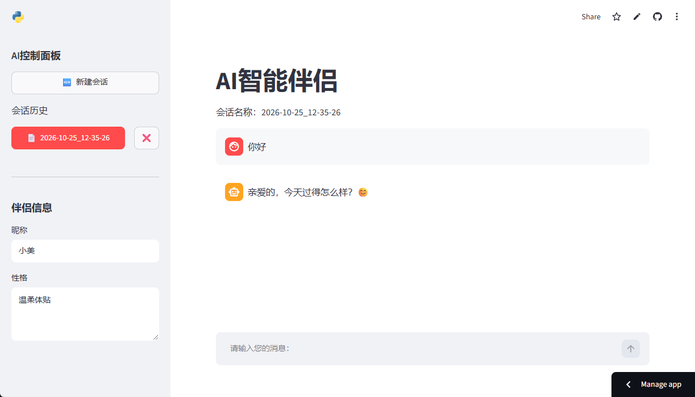

# AI 智能伴侣

**在线体验**：<https://ai-partner-wataq.streamlit.app>



基于 Streamlit + DeepSeek API 的角色扮演对话应用，支持多会话管理、自定义人设和流式输出。

## 功能

- 流式输出，回复逐字显示
- 多会话管理：新建 / 切换 / 删除，重启后不丢失
- 自定义昵称与性格，实时写入系统提示词
- 上下文窗口限制在最近 20 条，避免长时间对话超出模型上限
- 单会话最多 30 条消息，单条回复最多 300 tokens，控制调用额度
- 调用失败自动回滚，不会留下重复的用户消息

## 技术栈

- Python 3.10+
- Streamlit：页面、会话状态、流式渲染
- OpenAI SDK：通过兼容端点调用 DeepSeek
- JSON 文件持久化会话

## 本地运行

安装依赖：

```bash
pip install -r requirements.txt
```

配置 API Key，二选一。

环境变量：

```bash
set DEEPSEEK_API_KEY=你的key
```

或者新建 `.streamlit/secrets.toml`：

```toml
DEEPSEEK_API_KEY = "你的key"
```

启动：

```bash
streamlit run ai_partner_7.py
```

## 实现细节

几处不是照教程抄的：

- 路径跟着代码走（`Path(__file__).parent`），换机器不用改配置
- 上下文只取最近 20 条，避免多轮对话把窗口撑爆
- 单会话 30 条消息、单条回复 300 tokens 的双重上限，控制调用成本
- 调用失败时回滚刚发出的用户消息，重试不会产生重复对话
- 鉴权失败不回显原始异常，避免把 key 片段暴露给访问者
- 新建会话不落空文件，历史列表保持干净

## 目录结构

```
.
├── ai_partner_7.py      主程序
├── assets/sample.png    侧边栏 logo
├── assets/screenshot.png 界面截图
├── sessions/            会话存档（不上传）
├── requirements.txt
└── README.md
```

## 说明

`sessions/` 存放个人聊天记录，`.streamlit/secrets.toml` 存放密钥，两者都已加入 `.gitignore`。
